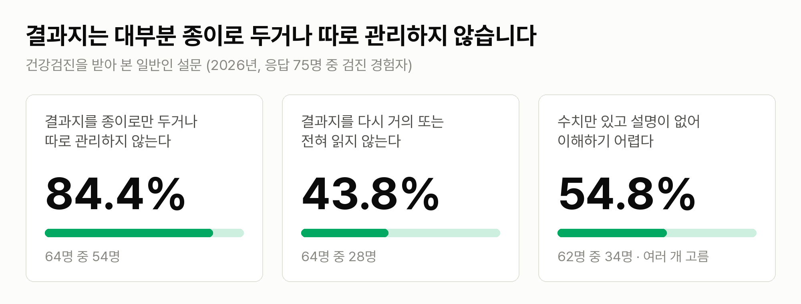
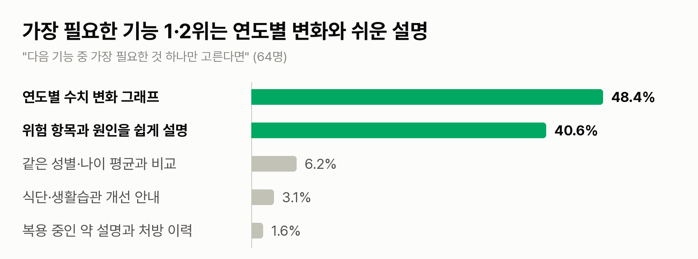
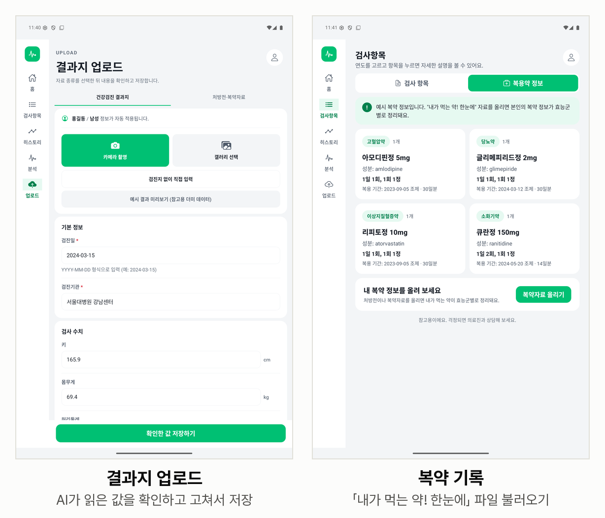
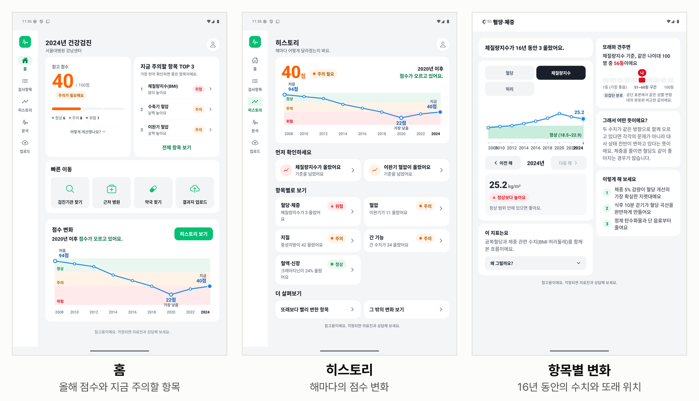
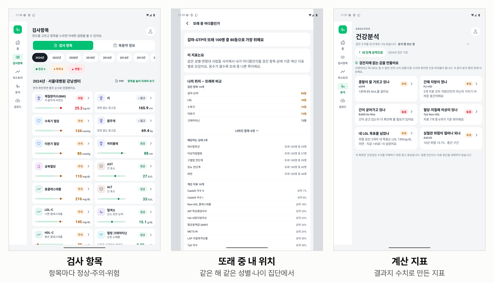
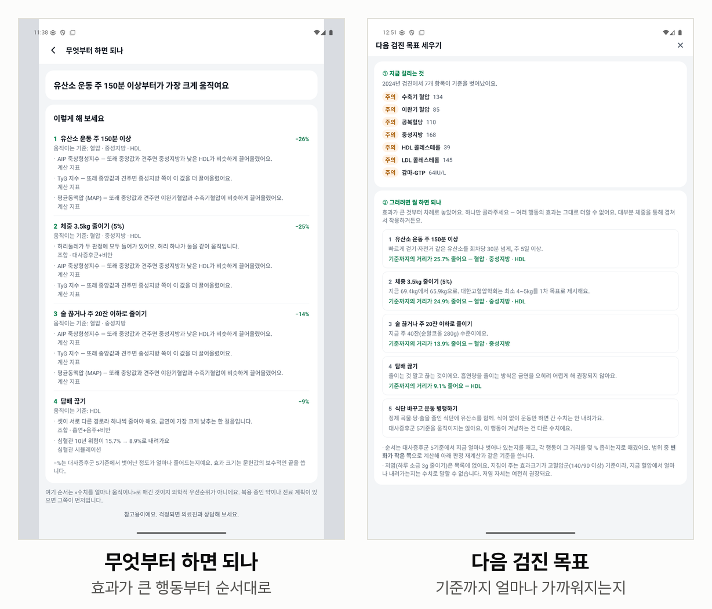
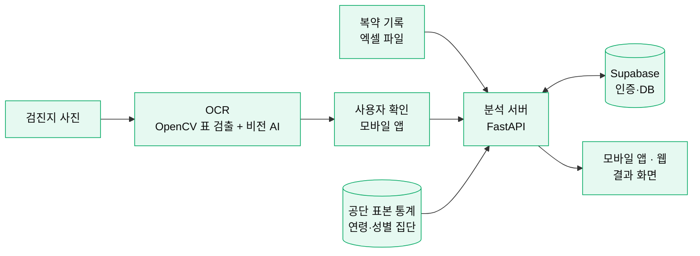

# 헬스에이지 (HealthAge)

사진 한 장으로 읽는 건강검진 분석 서비스

제주대학교 컴퓨터공학전공 팀 **코드짜는 한라봉** (강승준 · 고강혁 · 양인권)

건강검진 결과지를 사진으로 찍으면 AI가 수치를 읽어 기록하고, 국민건강보험공단 검진 데이터 1,596만 건과 비교해 내 건강 상태를 쉽게 알려 주는 개인 건강 분석 서비스입니다. 연도별 변화와 또래 비교, 결과지 수치로 계산하는 건강 지표에 복용 중인 약까지 반영해, 다음 검진까지 무엇을 챙기면 좋을지 안내합니다.

[필요성](#필요성) · [주요 기능](#주요-기능) · [판정 근거](#판정-근거) · [결과](#결과) · [개발 과정](#개발-과정) · [팀](#팀) · [시스템 구성](#시스템-구성) · [직접 실행](#직접-실행)

## 바로 보기

- **웹 체험판**: https://lumos0107.github.io/HealthAge/
  데모 계정으로 자동 로그인됩니다. 분석 서버 없이 데모 데이터로 동작하며, 결과지 사진을 골라도 서버로 보내지 않고 예시 값을 보여 줍니다.
- **안드로이드 체험판**: [Releases](https://github.com/lumos0107/HealthAge/releases/tag/co-show-2026)
  2026 CO-SHOW 전시에서 쓴 APK입니다. 설치 뒤 오른쪽 위 사람 모양을 눌러 데모 계정 root / 1234로 로그인합니다(서버 없이 도는 데모 데이터).

## 필요성

건강검진은 2년마다 받지만, 결과지는 대부분 종이로 쌓이기만 하고 잘 활용되지 않습니다. 일반인에게 설문하고(2026년, 응답 75명 가운데 검진 경험이 있고 이후 문항에 답한 64명 기준), 학과 교수 4명을 인터뷰했습니다.



설문에서 나온 문제는 네 가지이고, 헬스에이지의 기능은 이 문제에 하나씩 대응합니다.

| 문제 | 설문 결과 | 헬스에이지가 하는 일 |
|---|---|---|
| 관리가 안 된다 | 결과지를 따로 보관해야 해서 불편 53.4%, 변화량을 직접 계산해야 해서 불편 32.8% | 결과지 사진 한 장으로 수치를 읽어 해마다 쌓고, 변화를 그래프로 보여 줌 |
| 이해가 안 된다 | 수치만 있고 설명이 없음 54.8%, 전문 용어가 많음 50.0% | 항목마다 정상·주의·위험과 쉬운 설명 |
| 무엇이 중요한지 모른다 | 어떤 항목이 중요한지 모름 46.8% | 지금 주의할 항목, 결과지 수치로 계산한 지표, 같은 나이·성별 또래와 비교 |
| 행동으로 이어지지 않는다 | 읽어도 어떻게 해야 할지 모름 17.7%, 상담에서 주로 들은 내용이 생활습관 조언인 사람 4.7% | 다음 검진까지 챙길 생활 습관과 목표 |



가장 필요한 기능으로 고른 1·2위도 연도별 변화 그래프와 위험 항목 쉬운 설명이었습니다. 이 두 가지가 앱의 중심 화면인 히스토리와 건강분석이 되었습니다.

**교수 인터뷰** (학과 교수 4명, 2026년 4월)

- 결과지에서는 위험 표시만 보고 해석지는 거의 읽지 않으며, 정상인지 아닌지만 확인한다고 했습니다.
- 병원마다 결과가 흩어져 지난 결과와 이어 보기 어렵고, 과거 기록을 이어 보는 기능이 도움이 된다고 했습니다.
- 한 명은 평균 비교나 그래프만으로는 부족하고 실제 행동으로 이어져야 한다고 했습니다. 이 의견이 '행동' 기능의 출발점입니다.

**공공 데이터**

- 국민건강보험공단은 검진 표본을 해마다 약 100만 명분 공개하지만, 이름 없는 표본 자료라 개인이 내 결과지와 바로 견주어 보기 어렵습니다.
- 헬스에이지는 2009\~2024년 표본 1,596만 건을 해마다 성별·나이 집단으로 묶어, 내 수치가 같은 해 같은 성별·나이 집단에서 어디쯤인지 보여 줍니다.

설문 응답자는 50대(66.7%)와 여성(62.5%)이 많아, 다른 나이대에서는 결과가 다를 수 있습니다. 설문 원문 정리는 [docs/planning/일반인설문-75명-결과-정리.md](docs/planning/일반인설문-75명-결과-정리.md), 인터뷰 정리는 [docs/planning/2026-04-회의와-교수인터뷰-정리.md](docs/planning/2026-04-회의와-교수인터뷰-정리.md)에 있습니다.

## 주요 기능

결과지 사진 한 장으로 시작해 **읽고, 쌓고, 이해하고, 행동으로 잇는** 네 단계입니다. 아래 화면은 태블릿 화면이고(같은 앱이 폰 화면에도 맞춰 바뀝니다), 화면 속 이름과 수치는 모두 데모 데이터입니다.

### 1. 읽기: 사진 한 장으로 읽고, 확인해서 저장



- 결과지를 찍거나 사진을 고르면 OpenCV로 표를 찾고, 비전 AI(OCR)가 측정 16항목과 생활습관 2항목을 읽습니다.
- 읽은 값은 자동으로 저장하지 않습니다. 사용자가 확인하고 고친 뒤 저장하고, 이미지에서 근거를 찾지 못한 값은 버립니다.
- 심평원 「내가 먹는 약! 한눈에」에서 내려받은 복약 기록 파일을 불러와 복용 중인 약을 함께 기록합니다.

### 2. 쌓기: 해마다의 변화를 한 화면에서



- 홈에서는 올해 참고 점수와 지금 주의할 항목을 먼저 보여 줍니다. 참고 점수는 100점에서 주의 항목마다 6점, 위험 항목마다 12점을 뺀 값입니다.
- 히스토리에서는 점수와 항목별 수치가 해마다 어떻게 바뀌었는지 그래프로 봅니다. 병원이 달라도 한 기록으로 이어집니다.

### 3. 이해: 내 수치가 무슨 뜻인지



- 항목마다 정상·주의·위험을 표시하고, 무엇을 뜻하는지 쉬운 말로 설명합니다.
- 공단 표본으로 검진 연도의 같은 성별·나이 집단 중 내 위치(예: 100명 중 80등)와, 나와 같은 위험 요인 조합을 가진 사람의 비율을 보여 줍니다.
- 결과지 수치로 계산식 20종(지방간 지수 FLI·HSI, 심혈관 10년 위험, 약 용량 참고용 신장 기능 CrCl, 결과지에 있는 eGFR의 재계산 등)을 계산하고, LDL 개인 목표와 지방간 유형 두 가지를 판정합니다.
- 약 덕분에 정상 범위에 있는 수치는 따로 구분해, 약을 먹는 사람이 '정상'으로 잘못 읽히지 않게 했습니다.

### 4. 행동: 다음 검진까지 무엇부터



- 효과 크기 근거로 할 일의 순서를 정합니다(예: 유산소 운동 주 150분 이상, 체중 5% 줄이기, 술 줄이기, 담배 끊기). 근거는 [생활습관 효과 크기 조사](docs/evidence/2026-07-30-생활습관-효과크기-근거.md)에 있습니다.
- 순서는 대사증후군 기준에서 벗어난 정도를 얼마나 줄이는지로 매긴 것이고, 의학적 우선순위가 아니라는 점을 화면에 밝힙니다.
- 다음 검진 목표를 세우면 행동마다 기준까지의 거리가 얼마나 줄어드는지 보여 줍니다.

## 판정 근거

판정에는 자체 학습한 머신러닝 예측 모델을 쓰지 않고, 출처를 밝힐 수 있는 공개 근거만 씁니다. 그래서 화면의 결과마다 왜 그렇게 나왔는지 설명할 수 있습니다.

| 근거 | 쓰는 곳 |
|---|---|
| 국민건강보험공단 건강검진 표본 2009\~2024년, 1,596만 건<br>[16년 5축 재분석](docs/analysis/2026-07-29-공단표본-16년-5축-재분석.md) | 같은 해 같은 성별·나이 집단 중 내 위치, 단일 위험군 13개·조합 12개의 비율 |
| 학회 진료지침·교육자료 8종: 고혈압(2026), 당뇨병(2025), 이상지질혈증(2022), 대사증후군(2021·2024), 지방간 MASLD(2025)·NAFLD(2021)·알코올성 간질환(2013)<br>[진료지침 원문 검증](docs/evidence/2026-07-20-의학근거-원문검증.md) | 항목별 정상·주의·위험 기준, LDL 개인 목표, 지방간 유형 |
| 공개된 계산식<br>[계산기 목록](docs/analysis/2026-07-21-계산기-카탈로그.md) | 신장 기능 eGFR(CKD-EPI 2021)·CrCl, 지방간 지수 FLI·HSI, 심혈관 10년 위험(ASCVD·PREVENT·Framingham·SCORE2), 지질·인슐린 저항 지표(Non-HDL·TyG 등) |
| 생활습관 효과 크기 연구<br>[생활습관 효과 크기 조사](docs/evidence/2026-07-30-생활습관-효과크기-근거.md) | 할 일의 순서, 목표까지 줄어드는 거리 |

전문가 의견과 검증은 이렇게 반영했습니다.

- **약학대학 교수 자문** (2026년 5월): 진료지침 자료를 받아 기준을 다시 세웠습니다. 노인 혈압 기준을 조정하고, 복용 중인 약을 반영해 약 덕분에 정상인 수치를 따로 구분하고, 진단이 아니라 참고 정보라는 안내를 넣었습니다.
- **기업 멘토링 3회** (㈜제우스, 2026년 4\~5월): 대상과 기능을 좁히고(1차), 완성형 AI보다 웹 시제품을 먼저 만들고 결과지를 영역별로 나눠 읽게 했습니다(2차). 내 값·또래 평균·정상 기준을 함께 보여 주고, 자동 저장 대신 사용자가 확인하고 고치게 했습니다(3차).
- **진료지침 원문 대조** (2026년 7월): 요약본만 보고 만든 기준을 원문과 맞춰 보고 다섯 곳을 바로잡았습니다(LDL 목표치, LDL 초고위험군 범위, 노인 혈압 기준, 지방간 위험인자 구성, 알코올성 간질환 경계).

## 결과

| 구분 | 내용 |
|---|---|
| 대회 | 2026 In-Jeju Challenge 수상(수상 5개 팀이 CO-SHOW 성과 전시에 참가) |
| 전시 | CO-SHOW 2026 (2026-11-18\~21, 광주 김대중컨벤션센터). 태블릿 체험과 QR 웹 체험판으로 부스 시연 |
| OCR | 개인정보를 가린 실제 공단 결과통보서로 시험해 측정 16항목을 모두 읽음(16/16). 결과지 이미지를 6도 기울여 넣은 기울기 보정 시험에서도 16/16. 직접 찍은 사진 여러 장으로 시험하는 것이 다음 과제 |
| 자동 시험 | 분석 서버 124개 통과, 모바일 앱 162개 통과 (2026-11-22). 분석 서버의 13개는 저장소에 넣지 않은 시험용 결과지 이미지가 필요하거나 통합 시험으로 따로 빼서 건너뜀 |
| 개발 기록 | 커밋 300여 개(2026-07-19부터), 설계·분석·근거 문서는 [docs/README.md](docs/README.md) |

## 개발 과정

| 시기 | 한 일 |
|---|---|
| 2026년 3\~5월 | 첫 제안(머신러닝 질병 예측), 기업 멘토링 3회, 학과 교수 4명 인터뷰, 일반인 설문 75명, 약학대학 교수 자문. 예측 대신 공단 통계와 진료지침으로 설명하는 방향으로 바꿈 |
| 6월 | S.M.A.R.T 토너먼트 발표, WITHUS 결과보고서 제출 |
| 7월 | 백엔드·웹·모바일 통합(7/19, 이 저장소의 첫 커밋), 진료지침 원문 검증, 공단 표본 16년 1,596만 건 재분석, 앱 기능·디자인 개편 |
| 8월 | In-Jeju Challenge 본선 발표와 부스 시연. 수상 5개 팀에 들어 CO-SHOW 성과 전시에 참가 |
| 9\~10월 | CO-SHOW 부스 계획과 전시물 준비(코드 변경 없음) |
| 11월 | 태블릿 화면과 결과 요약 PDF(11/15\~17), CO-SHOW 전시(11/18\~21, 광주) |

단계별 자료(회의·인터뷰, 설문, 근거 검증, 분석, 설계 기록, 발표자료, 결과보고서, 전시 그림)는 [docs/README.md](docs/README.md)에 정리했습니다.

## 팀

| 이름 | 맡은 일 |
|---|---|
| 강승준 (팀장) | 기획, 수요 조사(설문·인터뷰·멘토링), 공단 표본 분석, 진료지침 대조, 백엔드 |
| 양인권 | OCR 파이프라인, 분석 서버(FastAPI), DB(Supabase), 복약 기록 읽기 |
| 고강혁 | 모바일 앱(React Native·Expo), 웹판(React·Vite), 화면 구조 설계 |

(역할은 2026년 8월 In-Jeju Challenge 발표자료의 팀 구성 기준입니다.)

## 시스템 구성



| 부분 | 기술 |
|---|---|
| 모바일·태블릿 앱 | React Native 0.81, Expo SDK 54, TypeScript (웹 체험판은 이 앱을 웹으로 빌드한 것) |
| 웹판 | React 19, Vite 7, TypeScript (분석 서버에 연결해 쓰는 큰 화면판, 체험판 아님) |
| 분석 서버 | Python 3.11\~3.13, FastAPI, pandas |
| OCR | OpenCV 표 검출 + 비전 언어 모델 (기본: 로컬 Ollama qwen2.5vl, 설정으로 Gemini 전환 가능) |
| 인증·DB | Supabase (PostgreSQL) |

## 폴더 구성

| 폴더 | 내용 |
|---|---|
| `frontend-mobile/` | 모바일·태블릿 앱 (전시 시연에 쓴 앱) |
| `backend/` | 분석 서버, OCR 파이프라인, 판정 기준, DB 스키마(`backend/sql/`) |
| `backend/data/stats/` | 공단 표본에서 만든 연령·성별 집단 통계 (원자료는 넣지 않음) |
| `frontend/` | 웹판 (분석 서버 필요) |
| `HealthAge-Design/` | 화면·기능별 설계와 디자인 규칙 |
| `docs/` | 기획과 조사(`planning/`), 의학 근거(`evidence/`), 공단 표본 분석(`analysis/`), 설계 기록(`design/`), 대회·전시 자료(`presentations/`) |
| `tools/` | 데모 데이터와 시험용 결과지(개인정보를 가짜 값으로 바꾼 것) 만들기 |
| `모바일앱사용설명서제작/` | 사용 설명서용 화면 캡처 |

## 직접 실행

서버 없이 앱만 보기 (`.env` 없이 실행하면 데모 계정 root / 1234로 로그인됩니다)

```bash
cd frontend-mobile
npm ci
npx expo start --web
npm test
```

분석 서버까지 쓰기 (Python 3.11\~3.13. `backend/.env.example`을 `.env`로, `frontend-mobile/.env.example`을 `frontend-mobile/.env`로 복사해 Supabase 주소와 키를 넣은 뒤)

```bash
cd backend
uv sync
uv run uvicorn app.main:app --reload
uv run pytest
```

분석 서버 시험만 돌릴 때는 `backend/.env.example`을 그대로 `backend/.env`로 복사하면 됩니다(124개 통과, 13개 건너뜀).

Supabase를 설정하면 root / 1234 데모 로그인은 꺼집니다(`EXPO_PUBLIC_ENABLE_DEMO=1`로 다시 켤 수 있음). 모바일 앱 설정은 `frontend-mobile/FRONTEND.md`에 있습니다.

## 데이터와 개인정보

- 또래 비교는 국민건강보험공단 건강검진정보(2009\~2024년, 1,596만 건)를 연령·성별 집단 통계로 줄인 값만 씁니다. 원자료는 이 저장소에 없습니다.
- 이 저장소에는 실제 검진 결과지나 개인정보가 들어 있지 않습니다. 화면과 시험에 쓴 값은 데모 데이터이고, 시험용 결과지는 이름·주민번호·검진의사 정보 등을 가짜 값으로 바꿔 만들었습니다.

## 저장소 안내

- 팀 비공개 저장소의 개발 기록(2026-07-19부터 커밋 297개)을 옮기고, 공개하면서 정리한 커밋을 그 뒤에 더했습니다. 5\~6월 백엔드 첫 판은 팀원 저장소에서 만들어 7/19 첫 커밋에 합쳤고, 통합 뒤의 커밋은 대부분 팀장 계정(lumos0107)으로 올렸습니다.
- 공개하면서 기록 전체에서 검진의사 정보, 실제 검진 수치, 서버 계정 비밀번호를 가렸습니다. 위의 root / 1234는 서버 없이 도는 데모 전용 계정입니다.
- 웹 체험판 빌드 결과는 `gh-pages` 브랜치에 있습니다.

※ 본 서비스는 참고용이며 의학적 진단을 대신하지 않습니다.
