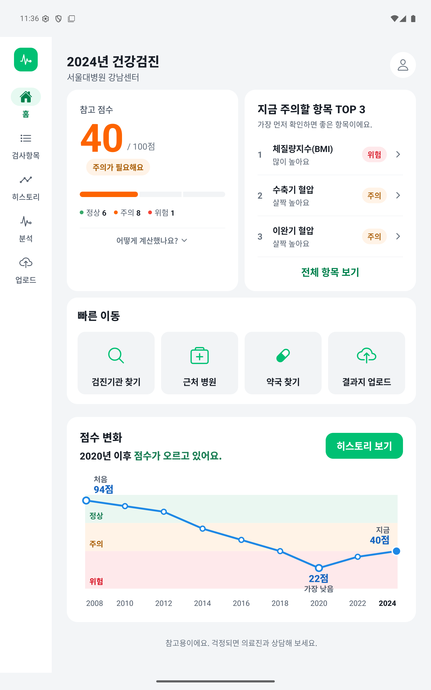
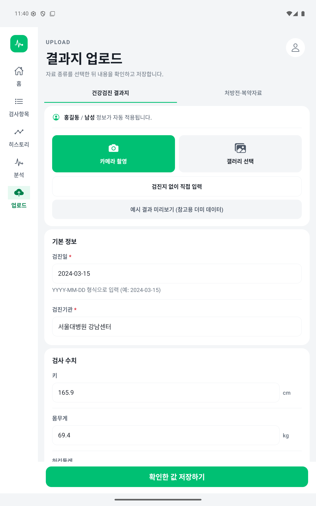
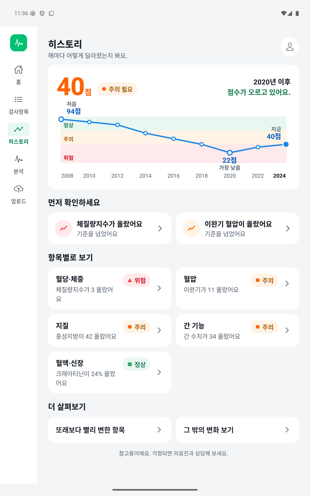
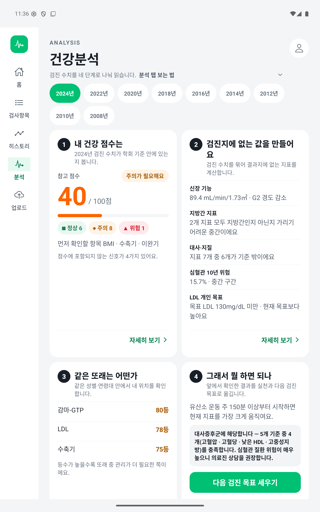
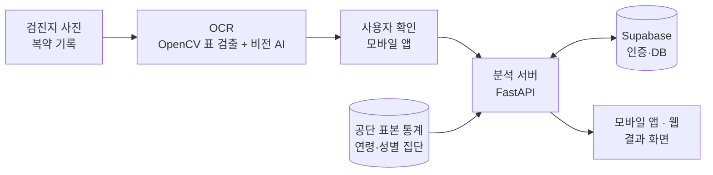

# 헬스에이지 (HealthAge)

사진 한 장으로 읽는 건강검진 분석 서비스

제주대학교 컴퓨터공학전공 팀 **코드짜는 한라봉**

| 이름 | 맡은 일 |
|---|---|
| 강승준 (팀장) | 기획, 수요 조사(설문·인터뷰·멘토링), 공단 표본 분석, 진료지침 대조, 백엔드 |
| 양인권 | OCR 파이프라인, 분석 서버(FastAPI), DB(Supabase), 복약 기록 읽기 |
| 고강혁 | 모바일 앱(React Native·Expo), 웹판(React·Vite), 화면 구조 설계 |

(역할은 2026년 8월 In-Jeju Challenge 발표자료의 팀 구성 기준입니다.)

건강검진 결과지를 사진으로 찍으면 AI가 수치를 읽어 기록하고, 국민건강보험공단 검진 데이터 1,596만 건과 비교해 내 건강 상태를 쉽게 알려 주는 개인 건강 분석 서비스입니다. 연도별 변화와 또래 비교, 결과지 수치로 계산하는 건강 지표에 복용 중인 약까지 반영해, 다음 검진까지 무엇을 챙기면 좋을지 안내합니다.

## 바로 보기

| 구분 | 주소 | 비고 |
|---|---|---|
| 웹 체험판 | https://lumos0107.github.io/HealthAge/ | 데모 계정으로 자동 로그인됩니다. 분석 서버 없이 데모 데이터로 동작하며, 결과지 사진을 골라도 서버로 보내지 않고 예시 값을 보여 줍니다. |
| 안드로이드 체험판 | [Releases](https://github.com/lumos0107/HealthAge/releases/tag/co-show-2026) | 2026 CO-SHOW 전시에서 쓴 APK. 설치 뒤 오른쪽 위 사람 모양을 눌러 데모 계정 root / 1234로 로그인합니다(서버 없이 도는 데모 데이터). |

## 화면

| 홈 | 결과지 업로드 | 히스토리 | 건강분석 |
|---|---|---|---|
|  |  |  |  |
| 올해 건강 점수, 지금 주의할 항목, 해마다의 점수 변화 | AI가 읽은 수치를 확인하고 고쳐서 저장 | 점수와 항목별 수치의 연도별 변화 | 또래 비교와 결과지 수치로 계산한 지표, 할 일 정리 |

(태블릿 화면입니다. 같은 앱이 폰 화면에도 맞춰 바뀝니다. 화면 속 이름과 수치는 모두 데모 데이터입니다.)

## 주요 기능

1. **촬영**: 결과지를 찍으면 비전 AI(OCR)가 측정 16항목과 생활습관 2항목을 읽습니다. 심평원 「내가 먹는 약! 한눈에」 복약 기록도 함께 불러옵니다.
2. **확인**: 읽은 값을 사용자가 확인하고 고친 뒤 저장합니다. 이미지에서 근거를 찾지 못한 값은 버려, 잘못 읽은 값이 저장되지 않게 했습니다.
3. **분석**: 공단 표본 1,596만 건으로 같은 나이·성별 또래와 비교하고, 정상·주의·위험 구간이 해마다 어떻게 바뀌었는지 봅니다. 결과지 수치로 지방간 지수(FLI·HSI)·심혈관 10년 위험·약 용량 참고용 신장 기능(CrCl) 등 22종을 계산·판정하고(결과지에 있는 eGFR도 공식으로 다시 계산), 약 덕분에 정상인 수치는 따로 구분합니다.
4. **행동**: 결과에 따라 다음 검진까지 챙길 생활 습관과 목표를 알려 줍니다.

판정은 자체 학습한 머신러닝 예측 모델 대신 공단 통계, 학회 진료지침·교육자료 8종, 공개된 심혈관 위험 계산식(ASCVD·PREVENT 등)을 근거로 하여, 결과가 왜 그렇게 나왔는지 설명할 수 있게 했습니다. 약학대학 교수 자문과 기업 멘토링 3회를 반영해 기준을 정했습니다.

## 개발 과정

| 시기 | 한 일 |
|---|---|
| 2026년 3\~5월 | 첫 제안(머신러닝 질병 예측), 기업 멘토링 3회, 학과 교수 4명 인터뷰, 일반인 설문 75명, 약학대학 교수 자문. 예측 대신 공단 통계와 진료지침으로 설명하는 방향으로 바꿈 |
| 6월 | S.M.A.R.T 토너먼트 발표, WITHUS 결과보고서 제출 |
| 7월 | 백엔드·웹·모바일 통합(7/19, 이 저장소의 첫 커밋), 진료지침 원문 검증, 공단 표본 16년 1,596만 건 재분석, 앱 기능·디자인 개편 |
| 8월 | In-Jeju Challenge 본선 발표와 부스 시연. 수상 5개 팀에 들어 CO-SHOW 성과 전시에 참가 |
| 9\~10월 | CO-SHOW 부스 계획과 전시물 준비(코드 변경 없음) |
| 11월 | 태블릿 화면과 결과 요약 PDF(11/15\~17), CO-SHOW 전시(11/18\~21, 광주) |

단계별 자료(회의·인터뷰, 설문, 근거 검증, 분석, 설계 기록, 발표자료, 결과보고서, 전시 그림)는 [docs/README.md](docs/README.md)에 정리했습니다.

## 시스템 구성



| 부분 | 기술 |
|---|---|
| 모바일·태블릿 앱 | React Native 0.81, Expo SDK 54, TypeScript (웹 체험판은 이 앱을 웹으로 빌드한 것) |
| 웹판 | React 19, Vite 7, TypeScript (분석 서버에 연결해 쓰는 큰 화면판, 체험판 아님) |
| 분석 서버 | Python 3.11\~3.13, FastAPI, pandas |
| OCR | OpenCV 표 검출 + 비전 언어 모델 (기본: 로컬 Ollama qwen2.5vl, 설정으로 Gemini 전환 가능) |
| 인증·DB | Supabase (PostgreSQL) |

## 폴더 구성

| 폴더 | 내용 |
|---|---|
| `frontend-mobile/` | 모바일·태블릿 앱 (전시 시연에 쓴 앱) |
| `backend/` | 분석 서버, OCR 파이프라인, 판정 기준, DB 스키마(`backend/sql/`) |
| `backend/data/stats/` | 공단 표본에서 만든 연령·성별 집단 통계 (원자료는 넣지 않음) |
| `frontend/` | 웹판 (분석 서버 필요) |
| `HealthAge-Design/` | 화면·기능별 설계와 디자인 규칙 |
| `docs/` | 기획과 조사(`planning/`), 의학 근거(`evidence/`), 공단 표본 분석(`analysis/`), 설계 기록(`design/`), 대회·전시 자료(`presentations/`) |
| `tools/` | 데모 데이터와 시험용 결과지(개인정보를 가짜 값으로 바꾼 것) 만들기 |
| `모바일앱사용설명서제작/` | 사용 설명서용 화면 캡처 |

## 직접 실행

서버 없이 앱만 보기 (`.env` 없이 실행하면 데모 계정 root / 1234로 로그인됩니다)

```bash
cd frontend-mobile
npm ci
npx expo start --web
npm test
```

분석 서버까지 쓰기 (Python 3.11\~3.13. `backend/.env.example`을 `.env`로, `frontend-mobile/.env.example`을 `frontend-mobile/.env`로 복사해 Supabase 주소와 키를 넣은 뒤)

```bash
cd backend
uv sync
uv run uvicorn app.main:app --reload
uv run pytest
```

Supabase를 설정하면 root / 1234 데모 로그인은 꺼집니다(`EXPO_PUBLIC_ENABLE_DEMO=1`로 다시 켤 수 있음). 모바일 앱 설정은 `frontend-mobile/FRONTEND.md`에 있습니다.

## 데이터와 개인정보

- 또래 비교는 국민건강보험공단 건강검진정보(2009\~2024년, 1,596만 건)를 연령·성별 집단 통계로 줄인 값만 씁니다. 원자료는 이 저장소에 없습니다.
- 이 저장소에는 실제 검진 결과지나 개인정보가 들어 있지 않습니다. 화면과 시험에 쓴 값은 데모 데이터이고, 시험용 결과지는 이름·주민번호·검진의사 정보 등을 가짜 값으로 바꿔 만들었습니다.

## 저장소 안내

- 팀 비공개 저장소의 개발 기록(2026-07-19부터 커밋 297개)을 옮기고, 공개하면서 정리한 커밋을 그 뒤에 더했습니다. 5\~6월 백엔드 첫 판은 팀원 저장소에서 만들어 7/19 첫 커밋에 합쳤습니다.
- 공개하면서 기록 전체에서 검진의사 정보, 실제 검진 수치, 서버 계정 비밀번호를 가렸습니다. 위의 root / 1234는 서버 없이 도는 데모 전용 계정입니다.
- 웹 체험판 빌드 결과는 `gh-pages` 브랜치에 있습니다.

※ 본 서비스는 참고용이며 의학적 진단을 대신하지 않습니다.
